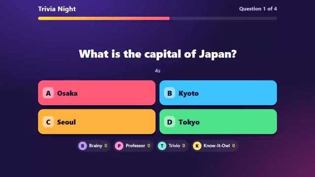

# Trivia Night

Quick questions you can change any time. A multiplayer starter game from [Multiplayer Agent](https://multiplayeragent.com): 2D, party, 2–12 players, with bots that fill empty seats.

## How it plays

Ten questions, 15 seconds each. Faster right answers score more. Swap the question pack whenever you like.

**Controls:** Click or tap an answer, or press 1 to 4.

## Make it yours in the Game Builder

Open the [Game Builder](https://multiplayeragent.com), choose **Start from a starter game** and pick Trivia Night. It opens as version 1 in your studio, ready to play and publish. Then ask for changes, for example:

- Add a picture round
- Make the last question worth double
- Make a question pack about movies

## Run it yourself

1. Get a free publishable key (`pk_…`) at [multiplayeragent.com](https://multiplayeragent.com).
2. In `index.html`, put it in place of `pk_REPLACE_ME` in the `MP_CONNECT` block.
3. Open `index.html` in a browser. No build step and no server needed.

Without a key it still runs, offline against bots.

## How it is built

- One `index.html`. The comment at the top of the script maps the code and explains the multiplayer.
- **Rounds:** Questions, timers and scores stay the same for everyone, even when the host leaves.
- **Leaderboard:** Each player's best game.
- **Bots:** Quiz bots play until enough people join.
- `?attract` runs it offline with bots only. The preview video is recorded from it.

## License

MIT.
